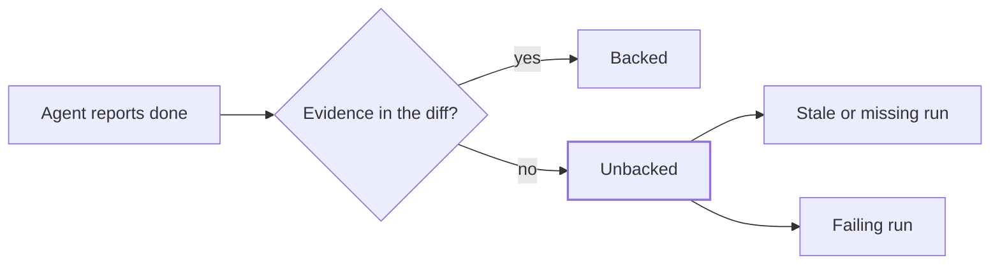
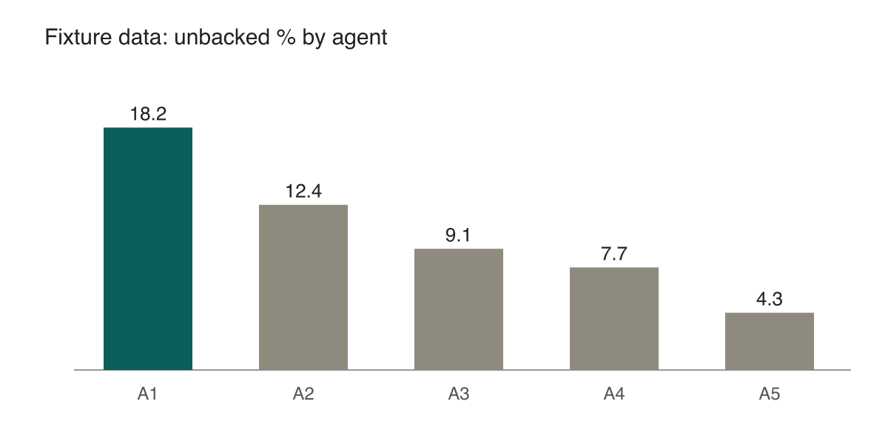

This post is a fixture. It exists to prove every element renders in light and dark, and it never ships because `draft` is true. All numbers below are fixture data, not results.

## A second-level heading

Body text is Source Serif 4 at 18 px on a 1.5 line height. Here is a paragraph with a [link to the Astro docs](https://docs.astro.build/) and a footnote reference[^1]. Paragraphs are separated by one blank line with no indent, and long enough lines should settle near 70 characters per line in the column.

voice fixture: not sure.. we start tomorrow... lets go -- ok "done" it's 3-4 hours atleast

### A third-level heading

> A blockquote sits behind a single rule. It carries the same face as the body, with no italics or decoration.

Inline code such as `getPosts()` uses the system monospace stack.

```ts
type Run = { agent: string; n: number; unbacked: number };

export function wilson(k: number, n: number, z = 1.96): [number, number] {
  const p = k / n;
  const d = 1 + (z * z) / n;
  const c = p + (z * z) / (2 * n);
  const m = z * Math.sqrt((p * (1 - p)) / n + (z * z) / (4 * n * n));
  return [(c - m) / d, (c + m) / d];
}
```

## A table

| Agent | n | Unbacked % (95% Wilson) | Stale | No run | Failing |
| --- | ---: | ---: | ---: | ---: | ---: |
| Claude Code | 412 | 18.2 (14.8–22.2) | 51 | 18 | 6 |
| Agent B | 268 | 12.4 (9.0–16.8) | 22 | 9 | 2 |
| Agent C | 190 | 9.1 (5.8–14.0) | 11 | 5 | 1 |
| Agent D | 131 | 7.7 (4.2–13.7) | 7 | 2 | 1 |

Fixture data. Numbers are right-aligned with tabular figures, and the interval is printed in the cell so the number exists without a chart.

## A diagram



## An image



The image above is a plain PNG on a white background, so the dark-mode treatment is visible.

[^1]: Footnotes are numbered endnotes with a back-link, set small and muted.
